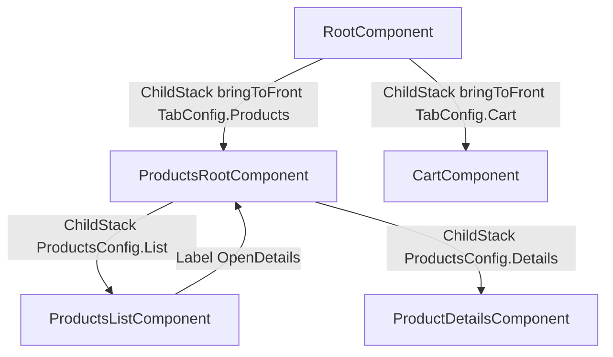

# PLAN.md — Kotlin Multiplatform e-commerce

Пошаговый план разработки простого e-commerce приложения под Android и iOS.
**Код приложения в этом файле не генерируется** — только архитектура, сигнатуры,
ключевые фрагменты и порядок работ.

Проект уже является шаблоном JetBrains KMP + Compose Multiplatform
(Kotlin 2.4.20, Compose MP 1.12.1, AGP 9.1.1, Gradle 9.8.0).
План опирается на этот каркас и не ломает рабочие точки входа.

---

## Summary архитектуры

Простое e-commerce на Kotlin Multiplatform + Compose Multiplatform: три экрана
(список товаров, деталка, корзина) и нижний таб-бар «Продукты» / «Корзина».
Данные только in-memory: `ProductsRepository` (хардкод) и `CartRepository`
(`MutableStateFlow` + `add` / `remove` / `observe`).

Четыре KMP-модуля: `:shared:data` ← `:shared:products` / `:shared:cart` ← `:shared` (root).
Feature-модули не зависят друг от друга. Навигация — Decompose
(`ChildStack` + `bringToFront` для табов, вложенный `ChildStack` список → деталка).
Состояние экранов — MVIKotlin Store, удержание через `instanceKeeper`.
DI — kotlin-inject без Anvil (`AppComponent` + feature-компоненты со store-factory).

Android-APK остаётся в `:androidApp`. Существующий `:shared` **не удаляется**:
это и есть root-модуль (`:shared:app` / `:shared:root` из исходного ТЗ).
Шаблон `Greeting` / `App()` в нём заменяется на Root / DI / навигацию.
iOS-фреймворк `Shared` (`isStatic = true`) остаётся в `:shared` —
Xcode-скрипт и `import Shared` не меняются.

---

## 1. Обзор архитектуры

### 1.1 Модули и зависимости

```
                 +------------------+
                 |   :androidApp    |   APK, тонкий MainActivity
                 +--------+---------+
                          |
                          v
+-------------------------+--------------------------+
|  :shared  (root)                                   |
|  RootComponent, DI, RootContent, MainViewController|
|  iOS framework Shared (isStatic = true)            |
+------------+------------------------+--------------+
             |                        |
             v                        v
   +---------+----------+    +--------+----------+
   | :shared:products   |    | :shared:cart      |
   | list + details     |    | Cart screen       |
   +---------+----------+    +--------+----------+
             |                        |
             +-----------+------------+
                         v
              +----------+-----------+
              |    :shared:data      |
              | Product, repositories|
              +----------------------+
```

Правила графа:

| Модуль | Зависит от | Не зависит от |
|---|---|---|
| `:shared:data` | только Kotlin stdlib + coroutines | features, root, Compose |
| `:shared:products` | `:shared:data` | `:shared:cart`, `:shared` |
| `:shared:cart` | `:shared:data` | `:shared:products`, `:shared` |
| `:shared` | `:shared:products`, `:shared:cart` | — |
| `:androidApp` | `:shared` | feature-модулей напрямую |

Общий тип между features — только `Product` из `:shared:data`.
Навигация между списком и деталкой живёт внутри `:shared:products`
(`ProductsRootComponent`). Корзина не знает про продукты-фичу.

### 1.2 Навигация (Decompose)



- Нижний таб-бар: `ChildStack<TabConfig, RootChild>` + `StackNavigation.bringToFront`.
  Оба таба остаются в стеке, состояние не уничтожается.
- Вкладка «Продукты»: вложенный `ChildStack` список → деталка.
- Вкладка «Корзина»: один `CartComponent`. `ChildSlot` не нужен.
- Альтернатива табам — `ChildPages` / `PagesNavigation` (свайп между вкладками).
  Для bottom bar без свайпа основной путь — `bringToFront`.

### 1.3 Поток данных одного экрана

```
UI (Compose *Content)
    | onIntent(Intent)
    v
Decompose Component  -- instanceKeeper.getOrCreate -->  MVIKotlin Store
    |                                                      |
    | collect labels  ---------------------------------->  Label (навигация)
    | collect states  <----------------------------------  State
    v
Repository (Flow)  <--- Executor / Bootstrapper
```

---

## 2. Структура проекта

Пакет-префикс как в текущем репозитории: `com.pustovit.mysundaykmpapp`.
Существующий `:shared` остаётся в `shared/`; новые модули — его дети на диске.

```
MySundayKmpApp/
├── PLAN.md
├── settings.gradle.kts
├── build.gradle.kts
├── gradle/
│   └── libs.versions.toml
├── androidApp/
│   ├── build.gradle.kts
│   └── src/main/
│       ├── AndroidManifest.xml
│       └── kotlin/com/pustovit/mysundaykmpapp/
│           └── MainActivity.kt
├── iosApp/
│   ├── iosApp/
│   │   ├── iOSApp.swift
│   │   └── ContentView.swift
│   └── iosApp.xcodeproj/
└── shared/                              # :shared  (root, уже есть)
    ├── build.gradle.kts
    ├── src/
    │   ├── commonMain/kotlin/com/pustovit/mysundaykmpapp/
    │   │   ├── root/
    │   │   │   ├── RootComponent.kt
    │   │   │   ├── DefaultRootComponent.kt
    │   │   │   └── RootContent.kt
    │   │   └── di/
    │   │       ├── AppScope.kt
    │   │       └── AppComponent.kt
    │   ├── androidMain/kotlin/com/pustovit/mysundaykmpapp/
    │   └── iosMain/kotlin/com/pustovit/mysundaykmpapp/
    │       └── MainViewController.kt    # уже есть, меняется тело
    ├── data/                            # :shared:data
    │   ├── build.gradle.kts
    │   └── src/commonMain/kotlin/com/pustovit/mysundaykmpapp/data/
    │       ├── model/
    │       │   └── Product.kt
    │       └── repository/
    │           ├── ProductsRepository.kt
    │           ├── InMemoryProductsRepository.kt
    │           ├── CartRepository.kt
    │           └── InMemoryCartRepository.kt
    ├── products/                        # :shared:products
    │   ├── build.gradle.kts
    │   └── src/commonMain/kotlin/com/pustovit/mysundaykmpapp/products/
    │       ├── di/
    │       │   └── ProductsFeatureComponent.kt
    │       ├── root/
    │       │   ├── ProductsRootComponent.kt
    │       │   ├── DefaultProductsRootComponent.kt
    │       │   └── ProductsRootContent.kt
    │       ├── list/
    │       │   ├── ProductsListComponent.kt
    │       │   ├── DefaultProductsListComponent.kt
    │       │   ├── ProductsListStore.kt
    │       │   ├── ProductsListStoreFactory.kt
    │       │   └── ProductsListContent.kt
    │       └── details/
    │           ├── ProductDetailsComponent.kt
    │           ├── DefaultProductDetailsComponent.kt
    │           ├── ProductDetailsStore.kt
    │           ├── ProductDetailsStoreFactory.kt
    │           └── ProductDetailsContent.kt
    └── cart/                            # :shared:cart
        ├── build.gradle.kts
        └── src/commonMain/kotlin/com/pustovit/mysundaykmpapp/cart/
            ├── di/
            │   └── CartFeatureComponent.kt
            ├── CartComponent.kt
            ├── DefaultCartComponent.kt
            ├── CartStore.kt
            ├── CartStoreFactory.kt
            └── CartContent.kt
```

Шаблонные файлы, которые **заменяются** (не удаляется модуль, только содержимое):

- `shared/src/commonMain/kotlin/com/pustovit/mysundaykmpapp/App.kt`
- `shared/src/commonMain/kotlin/com/pustovit/mysundaykmpapp/Greeting.kt`
- `shared/src/commonMain/kotlin/com/pustovit/mysundaykmpapp/GreetingUtil.kt`

`Platform.kt` / `Platform.android.kt` / `Platform.ios.kt` можно оставить
или удалить на шаге 4 — на бизнес-логику они не влияют.

---

## 3. Настройка Gradle

Версии проверены по текущему catalog проекта и Maven Central на **2026-10-25**.

### 3.1 Version Catalog — `gradle/libs.versions.toml`

Уже есть в проекте (не понижать):

| Координата | Версия |
|---|---|
| Kotlin | `2.4.20` |
| Compose Multiplatform | `1.12.1` |
| Compose Material3 | `1.12.0-alpha03` |
| AGP | `9.1.1` |
| compileSdk / targetSdk | `37` |
| minSdk | `24` |
| AndroidX Activity Compose | `1.13.0` |
| JVM target | `11` |
| Gradle Wrapper | `9.8.0` |

Добавить в catalog:

| Координата | Версия | Комментарий |
|---|---|---|
| Decompose | **`3.5.0`** (stable) | latest на Maven — `3.6.0-beta02` (2026-10-13). Fallback, если 3.5.0 не соберётся на Kotlin 2.4.20 |
| MVIKotlin | `4.4.0` | |
| kotlinx-coroutines | `1.11.0` | |
| kotlinx-serialization | `1.12.0` | |
| kotlin-inject | `0.9.0` | `kotlin-inject-runtime-kmp` + `kotlin-inject-compiler-ksp` |
| KSP | `2.3.12` | новая нумерация без префикса Kotlin. На шаге 1 проверить совместимость с Kotlin `2.4.20`; если появится `2.4.20-*` — взять её |
| Essenty | не пинить | тянется транзитивно из Decompose 3.5.0 |

Фрагмент секций, которые нужно **добавить** (существующие блоки не переписывать целиком):

```toml
[versions]
# ... существующие kotlin / compose / agp ...
decompose = "3.5.0"
mvikotlin = "4.4.0"
coroutines = "1.11.0"
serialization = "1.12.0"
kotlinInject = "0.9.0"
ksp = "2.3.12"

[libraries]
# Decompose
decompose = { module = "com.arkivanov.decompose:decompose", version.ref = "decompose" }
decompose-compose = { module = "com.arkivanov.decompose:extensions-compose", version.ref = "decompose" }

# MVIKotlin
mvikotlin = { module = "com.arkivanov.mvikotlin:mvikotlin", version.ref = "mvikotlin" }
mvikotlin-main = { module = "com.arkivanov.mvikotlin:mvikotlin-main", version.ref = "mvikotlin" }
mvikotlin-coroutines = { module = "com.arkivanov.mvikotlin:mvikotlin-extensions-coroutines", version.ref = "mvikotlin" }

# Coroutines / serialization
kotlinx-coroutines-core = { module = "org.jetbrains.kotlinx:kotlinx-coroutines-core", version.ref = "coroutines" }
kotlinx-serialization-core = { module = "org.jetbrains.kotlinx:kotlinx-serialization-core", version.ref = "serialization" }

# kotlin-inject
kotlinInject-runtime = { module = "me.tatarka.inject:kotlin-inject-runtime-kmp", version.ref = "kotlinInject" }
kotlinInject-compiler = { module = "me.tatarka.inject:kotlin-inject-compiler-ksp", version.ref = "kotlinInject" }

[plugins]
# ... существующие ...
kotlinSerialization = { id = "org.jetbrains.kotlin.plugin.serialization", version.ref = "kotlin" }
ksp = { id = "com.google.devtools.ksp", version.ref = "ksp" }
```

`kotlin-inject-anvil` (`software.amazon.lastmile.kotlin.inject.anvil:0.1.7`, январь 2026)
**не подключать**: не стыкуется с kotlin-inject `0.9.0` и Kotlin `2.4.20`.

### 3.2 Корневые файлы

`settings.gradle.kts` — оставить `:androidApp` и `:shared`, добавить детей:

```kotlin
include(":androidApp")
include(":shared")
include(":shared:data")
include(":shared:products")
include(":shared:cart")
```

Каталоги `shared/data`, `shared/products`, `shared/cart` — дети существующего `shared/`.
Исходники root остаются в `shared/src`. **Не** перемещать их в `shared/app`.

Корневой `build.gradle.kts` — `apply false` для новых плагинов:

```kotlin
alias(libs.plugins.kotlinSerialization) apply false
alias(libs.plugins.ksp) apply false
```

### 3.3 Общий каркас KMP-модуля (AGP 9)

Все четыре KMP-модуля используют тот же стиль, что уже есть в
`shared/build.gradle.kts`:

- плагин `com.android.kotlin.multiplatform.library` (`androidMultiplatformLibrary`);
- блок `android { }` **внутри** `kotlin { }`, не снаружи;
- **не** старый `com.android.library`.

Таргеты (как в текущем шаблоне):

```kotlin
android { /* namespace / compileSdk / minSdk / jvmTarget 11 */ }
iosArm64()
iosSimulatorArm64()
```

`iosX64()` — только если нужна сборка на Intel Mac. В дефолтный каркас
не включать: текущий шаблон его сознательно убрал.

iOS-фреймворк производить **только** в `:shared` (уже настроено):

```kotlin
listOf(iosArm64(), iosSimulatorArm64()).forEach { iosTarget ->
    iosTarget.binaries.framework {
        baseName = "Shared"
        isStatic = true
    }
}
```

Feature- и data-модули фреймворк **не** публикуют.

### 3.4 Какие зависимости куда

| Зависимость | `:shared:data` | `:shared:products` | `:shared:cart` | `:shared` | `:androidApp` |
|---|:---:|:---:|:---:|:---:|:---:|
| `kotlinx-coroutines-core` | api | — (транзитивно) | — (транзитивно) | — | — |
| `project(":shared:data")` | — | api | api | — (транзитивно) | — |
| `project(":shared:products")` | — | — | — | implementation | — |
| `project(":shared:cart")` | — | — | — | implementation | — |
| `project(":shared")` | — | — | — | — | implementation |
| Compose (runtime, foundation, material3, ui) | — | implementation | implementation | implementation | tooling |
| `decompose` + `decompose-compose` | — | implementation | implementation | implementation | implementation |
| `mvikotlin` + `mvikotlin-main` + `mvikotlin-coroutines` | — | implementation | implementation | implementation | — |
| `kotlinx-serialization-core` + plugin | — | implementation | — | implementation | — |
| `kotlinInject-runtime` | — | implementation | implementation | implementation | — |
| KSP `kotlinInject-compiler` | — | да | да | да | — |
| `androidx-activity-compose` | — | — | — | — | implementation |

`data` отдаёт репозитории как `api`, чтобы features видели `Product` и интерфейсы.

Плагины по модулям:

| Плагин | data | products | cart | shared | androidApp |
|---|:---:|:---:|:---:|:---:|:---:|
| `kotlinMultiplatform` | + | + | + | + | — |
| `androidMultiplatformLibrary` | + | + | + | + | — |
| `androidApplication` | — | — | — | — | + |
| `composeMultiplatform` + `composeCompiler` | — | + | + | + | compiler |
| `kotlinSerialization` | — | + | — | + | — |
| `ksp` | — | + | + | + | — |

KSP для KMP (в модулях с `@Component` / `@Inject` factory):

```kotlin
dependencies {
    add("kspAndroid", libs.kotlinInject.compiler)
    add("kspIosArm64", libs.kotlinInject.compiler)
    add("kspIosSimulatorArm64", libs.kotlinInject.compiler)
}
```

`androidApp` дополнительно: `decompose` — ради `defaultComponentContext()`
в `MainActivity`.

Namespace-ы Android (как принято в проекте):

| Модуль | `namespace` |
|---|---|
| `:androidApp` | `com.pustovit.mysundaykmpapp` (уже есть) |
| `:shared` | `com.pustovit.mysundaykmpapp.shared` (уже есть) |
| `:shared:data` | `com.pustovit.mysundaykmpapp.data` |
| `:shared:products` | `com.pustovit.mysundaykmpapp.products` |
| `:shared:cart` | `com.pustovit.mysundaykmpapp.cart` |

---

## 4. Слой data (`:shared:data`)

Пакет: `com.pustovit.mysundaykmpapp.data`.
Никаких БД, сети, Compose, Decompose, DI-аннотаций.

### 4.1 Модель

```kotlin
package com.pustovit.mysundaykmpapp.data.model

data class Product(
    val id: Long,
    val name: String,
    val price: Double,
)
```

`Product` не обязан быть `@Serializable`: в навигации передаётся только `productId: Long`.

### 4.2 Репозитории — интерфейсы

```kotlin
package com.pustovit.mysundaykmpapp.data.repository

interface ProductsRepository {
    fun observeProducts(): Flow<List<Product>>
    fun getProduct(id: Long): Product?
}

interface CartRepository {
    fun observeCart(): Flow<List<Product>>
    fun observeIsInCart(productId: Long): Flow<Boolean>
    fun add(product: Product)
    fun remove(productId: Long)
}
```

### 4.3 In-memory реализации

`InMemoryProductsRepository`:

- приватный неизменяемый список 6–8 товаров
  (например id 1..8, имена «Кофе», «Чай», …, цены `Double`);
- `observeProducts()` — `MutableStateFlow` / `flowOf` с этим списком;
- `getProduct(id)` — `products.firstOrNull { it.id == id }`.

`InMemoryCartRepository`:

- `private val items = MutableStateFlow<List<Product>>(emptyList())`;
- `observeCart(): Flow<List<Product>> = items`;
- `observeIsInCart(id) = items.map { list -> list.any { it.id == id } }.distinctUntilChanged()`;
- `add` — если id ещё нет, `items.update { it + product }`;
- `remove` — `items.update { it.filterNot { p -> p.id == productId } }`.

Экземпляры репозиториев живут в `AppScope` (создаёт `AppComponent`).
Пока процесс жив, корзина общая для деталки и вкладки «Корзина».

---

## 5. MVIKotlin для каждого экрана

Общие правила всех трёх Store:

- `StoreFactory` — один `DefaultStoreFactory` из DI (`AppScope`).
- Executor — `CoroutineExecutor` с `mainContext = Dispatchers.Main`.
- Bootstrapper — `CoroutineBootstrapper`, сразу `dispatch(Action.Init)`.
- Store создаётся в `instanceKeeper.getOrCreate { ... }` компонента
  и `dispose()` в `InstanceKeeper.Instance.onDestroy`.
- Labels собираются в `init` компонента через `componentContext.coroutineScope()`.
- UI читает `store.states` (расширение `mvikotlin-extensions-coroutines`).

Общий каркас factory (идея, не полная реализация):

```kotlin
internal class XxxStoreFactory(
    private val storeFactory: StoreFactory,
    // репозитории
) {
    fun create(/* аргументы экрана, например productId */): XxxStore =
        object : XxxStore, Store<Intent, State, Label> by storeFactory.create(
            name = "XxxStore",
            initialState = State(),
            bootstrapper = BootstrapperImpl(),
            executorFactory = ::ExecutorImpl,
            reducer = ReducerImpl,
        ) {}
}
```

### 5.1 ProductsListStore

Пакет: `com.pustovit.mysundaykmpapp.products.list`.

```kotlin
interface ProductsListStore : Store<Intent, State, Label> {

    sealed interface Intent {
        data class ProductClicked(val productId: Long) : Intent
    }

    data class State(
        val products: List<Product> = emptyList(),
    )

    sealed interface Label {
        data class OpenDetails(val productId: Long) : Label
    }
}
```

Внутренние типы factory (не часть публичного Store API):

```kotlin
private sealed interface Action {
    data object Init : Action
}

private sealed interface Message {
    data class SetProducts(val products: List<Product>) : Message
}
```

| Роль | Действия |
|---|---|
| Bootstrapper | `dispatch(Action.Init)` |
| Executor `executeAction(Init)` | `productsRepository.observeProducts().collect { dispatch(SetProducts(it)) }` |
| Executor `executeIntent(ProductClicked)` | `publish(Label.OpenDetails(id))` |
| Reducer | `SetProducts` → `copy(products = …)` |

Навигационного состояния в Store нет — только Label.

### 5.2 ProductDetailsStore

Пакет: `com.pustovit.mysundaykmpapp.products.details`.

Factory принимает `productId: Long`.

```kotlin
interface ProductDetailsStore : Store<Intent, State, Label> {

    sealed interface Intent {
        data object AddToCart : Intent
        data object RemoveFromCart : Intent
    }

    data class State(
        val product: Product? = null,
        val isInCart: Boolean = false,
    )

    sealed interface Label // не нужен — навигация «назад» идёт из Component / TopAppBar
}
```

```kotlin
private sealed interface Action { data object Init : Action }

private sealed interface Message {
    data class SetProduct(val product: Product?) : Message
    data class SetInCart(val isInCart: Boolean) : Message
}
```

| Роль | Действия |
|---|---|
| Bootstrapper | `dispatch(Action.Init)` |
| Executor `executeAction(Init)` | `dispatch(SetProduct(repo.getProduct(productId)))`; параллельно `cartRepository.observeIsInCart(productId).collect { dispatch(SetInCart(it)) }` |
| Executor `AddToCart` | `state().product?.let(cartRepository::add)` |
| Executor `RemoveFromCart` | `cartRepository.remove(productId)` |
| Reducer | `SetProduct` / `SetInCart` |

Кнопка в UI переключается по `state.isInCart`. Отдельный Label не нужен:
`Flow` корзины сам обновит State.

### 5.3 CartStore

Пакет: `com.pustovit.mysundaykmpapp.cart`.

```kotlin
interface CartStore : Store<Intent, State, Label> {

    sealed interface Intent {
        data class Remove(val productId: Long) : Intent
    }

    data class State(
        val items: List<Product> = emptyList(),
    )

    sealed interface Label // не нужен
}
```

```kotlin
private sealed interface Action { data object Init : Action }

private sealed interface Message {
    data class SetItems(val items: List<Product>) : Message
}
```

| Роль | Действия |
|---|---|
| Bootstrapper | `dispatch(Action.Init)` |
| Executor `executeAction(Init)` | `cartRepository.observeCart().collect { dispatch(SetItems(it)) }` |
| Executor `Remove` | `cartRepository.remove(productId)` |
| Reducer | `SetItems` → `copy(items = …)` |

### 5.4 Связка Store ↔ Decompose-компонент

Ключевой фрагмент (пример для списка; деталка и корзина — тот же паттерн):

```kotlin
class DefaultProductsListComponent(
    componentContext: ComponentContext,
    storeFactory: ProductsListStoreFactory,
    private val onProductSelected: (Long) -> Unit,
) : ProductsListComponent, ComponentContext by componentContext {

    private val store = instanceKeeper.getOrCreate {
        StoreHolder(storeFactory.create())
    }.store

    override val state: StateFlow<ProductsListStore.State> = store.stateFlow

    override fun onIntent(intent: ProductsListStore.Intent) = store.accept(intent)

    init {
        coroutineScope().launch {
            store.labels.collect { label ->
                when (label) {
                    is ProductsListStore.Label.OpenDetails ->
                        onProductSelected(label.productId)
                }
            }
        }
    }

    private class StoreHolder(
        val store: ProductsListStore,
    ) : InstanceKeeper.Instance {
        override fun onDestroy() {
            store.dispose()
        }
    }
}
```

Что здесь обязательно:

- `instanceKeeper` — Store переживает смену конфигурации / рекомпозицию;
- `store.dispose()` в `onDestroy` — иначе утекают корутины Executor;
- `coroutineScope()` — scope Essenty, привязанный к `Lifecycle` компонента
  (зависимость приходит транзитивно с Decompose; при необходимости явно
  `com.arkivanov.essenty:lifecycle-coroutines`);
- `onProductSelected` — лямбда от родителя, не зависимость на другой feature-модуль.

Если в используемой версии MVIKotlin 4.4.0 нет `stateFlow`, заменить на:

```kotlin
val state: StateFlow<State> = store.states.stateIn(
    scope = coroutineScope(),
    started = SharingStarted.Eagerly,
    initialValue = store.state,
)
```

Либо в Compose сразу `store.states.collectAsState(store.state)`.

---

## 6. Decompose-навигация

### 6.1 Root

Пакет: `com.pustovit.mysundaykmpapp.root`.

```kotlin
interface RootComponent {
    val stack: Value<ChildStack<*, Child>>
    fun onTabSelected(index: Int)

    sealed interface Child {
        class Products(val component: ProductsRootComponent) : Child
        class Cart(val component: CartComponent) : Child
    }
}
```

```kotlin
@Serializable
sealed interface TabConfig {
    @Serializable
    data object Products : TabConfig

    @Serializable
    data object Cart : TabConfig
}
```

`DefaultRootComponent(componentContext, appComponent: AppComponent)`:

```kotlin
private val navigation = StackNavigation<TabConfig>()

override val stack: Value<ChildStack<TabConfig, RootComponent.Child>> = childStack(
    source = navigation,
    serializer = TabConfig.serializer(),
    initialConfiguration = TabConfig.Products,
    handleBackButton = true,
    childFactory = ::child,
)

override fun onTabSelected(index: Int) {
    navigation.bringToFront(
        when (index) {
            0 -> TabConfig.Products
            else -> TabConfig.Cart
        }
    )
}
```

`childFactory`:

- `TabConfig.Products` → `Child.Products(DefaultProductsRootComponent(...))`
- `TabConfig.Cart` → `Child.Cart(DefaultCartComponent(...))`

Зависимости в детей прокидываются из DI (см. §8):
`ProductsFeatureComponent` / `CartFeatureComponent` + `ComponentContext` ребёнка.

`handleBackButton = true` на корне: из деталки система Back сначала делает
`pop` вложенного стека (если настроить `handleBackButton` там), затем уже
не уходит на другой таб без явного выбора.

### 6.2 Вложенный стек продуктов

Пакет: `com.pustovit.mysundaykmpapp.products.root`.

```kotlin
interface ProductsRootComponent {
    val stack: Value<ChildStack<*, Child>>

    sealed interface Child {
        class List(val component: ProductsListComponent) : Child
        class Details(val component: ProductDetailsComponent) : Child
    }
}

@Serializable
sealed interface ProductsConfig {
    @Serializable
    data object List : ProductsConfig

    @Serializable
    data class Details(val productId: Long) : ProductsConfig
}
```

`DefaultProductsRootComponent`:

```kotlin
private val navigation = StackNavigation<ProductsConfig>()

childStack(
    source = navigation,
    serializer = ProductsConfig.serializer(),
    initialConfiguration = ProductsConfig.List,
    handleBackButton = true,
    childFactory = ::child,
)
```

- `List` → `DefaultProductsListComponent(..., onProductSelected = { id ->
      navigation.pushNew(ProductsConfig.Details(id))
  })`
- `Details` → `DefaultProductDetailsComponent(..., onFinished = navigation::pop)`

`ProductsListComponent` не знает о `ProductDetailsComponent`.
Связь — только лямбда `onProductSelected: (Long) -> Unit`.

### 6.3 Экраны-компоненты

```kotlin
interface ProductsListComponent {
    val state: StateFlow<ProductsListStore.State>
    fun onIntent(intent: ProductsListStore.Intent)
}

interface ProductDetailsComponent {
    val state: StateFlow<ProductDetailsStore.State>
    fun onIntent(intent: ProductDetailsStore.Intent)
    fun onBack()
}

interface CartComponent {
    val state: StateFlow<CartStore.State>
    fun onIntent(intent: CartStore.Intent)
}
```

`ChildSlot` для корзины не заводить: вкладка и есть единственный child.

### 6.4 Как прокидывать зависимости

```
MainActivity / MainViewController
    └─ AppComponent::class.create()                         // kotlin-inject
         └─ DefaultRootComponent(ctx, appComponent)
              ├─ ProductsFeatureComponent::class.create(appComponent)
              │    └─ DefaultProductsRootComponent(childCtx, productsFeature)
              │         ├─ DefaultProductsListComponent(ctx, listStoreFactory, onProductSelected)
              │         └─ DefaultProductDetailsComponent(ctx, detailsStoreFactory, productId, onBack)
              └─ CartFeatureComponent::class.create(appComponent)
                   └─ DefaultCartComponent(childCtx, cartStoreFactory)
```

`Default*` компоненты **не** создаются kotlin-inject: им нужны
`ComponentContext` и лямбды навигации, которых нет в графе DI.

### 6.5 Альтернатива табам — `ChildPages`

Если понадобится свайп:

```kotlin
val pages = childPages(
    source = pagesNavigation,
    serializer = TabConfig.serializer(),
    initialPages = {
        Pages(items = listOf(TabConfig.Products, TabConfig.Cart), selectedIndex = 0)
    },
    childFactory = ::child,
)
```

UI: `ChildPages(pages, onPageSelected, scrollAnimation = PagesScrollAnimation.Disabled)`.
Для классического bottom bar без свайпа это лишнее — оставляем `bringToFront`.

---

## 7. UI (Compose Multiplatform)

Все `*Content` — `commonMain`, Material3.

Подписка на State — в обёртке, которая принимает компонент:

```kotlin
@Composable
fun ProductsListContent(component: ProductsListComponent) {
    val state by component.state.collectAsState()
    ProductsListContent(
        state = state,
        onIntent = component::onIntent,
    )
}

@Composable
fun ProductsListContent(
    state: ProductsListStore.State,
    onIntent: (ProductsListStore.Intent) -> Unit,
) { /* layout */ }
```

Так превью и тесты могут кормить State без Store.

### 7.1 `RootContent`

```kotlin
@Composable
fun RootContent(component: RootComponent) {
    val stack by component.stack.subscribeAsState()
    val active = stack.active.instance

    Scaffold(
        bottomBar = {
            NavigationBar {
                NavigationBarItem(
                    selected = active is RootComponent.Child.Products,
                    onClick = { component.onTabSelected(0) },
                    icon = { /* Icons.Default.ShoppingBag или аналог */ },
                    label = { Text("Продукты") },
                )
                NavigationBarItem(
                    selected = active is RootComponent.Child.Cart,
                    onClick = { component.onTabSelected(1) },
                    icon = { /* Icons.Default.ShoppingCart */ },
                    label = { Text("Корзина") },
                )
            }
        },
    ) { padding ->
        Children(
            stack = component.stack,
            modifier = Modifier.padding(padding),
        ) { child ->
            when (val instance = child.instance) {
                is RootComponent.Child.Products -> ProductsRootContent(instance.component)
                is RootComponent.Child.Cart -> CartContent(instance.component)
            }
        }
    }
}
```

`subscribeAsState()` / `Children` — из `com.arkivanov.decompose.extensions.compose`.

### 7.2 `ProductsRootContent`

`Children(component.stack)`:

- `Child.List` → `ProductsListContent`
- `Child.Details` → `ProductDetailsContent`

### 7.3 `ProductsListContent`

- `Scaffold` + `TopAppBar(title = "Продукты")`
- `LazyColumn`:
  - элемент — `Card` на всю ширину;
  - внутри колонка: `Text(product.name)`, `Text(price)`;
  - `Modifier.clickable { onIntent(ProductClicked(product.id)) }`.

### 7.4 `ProductDetailsContent`

- `TopAppBar(title = product?.name ?: "", navigationIcon = Back → component.onBack())`
- Тело: имя, цена.
- Низ / основная кнопка:
  - если `!state.isInCart` — «Добавить в корзину» → `Intent.AddToCart`;
  - если `state.isInCart` — «Удалить из корзины» → `Intent.RemoveFromCart`.
- Если `product == null` — текст «Товар не найден» (битый id).

### 7.5 `CartContent`

- `TopAppBar(title = "Корзина")`
- пустой список — «Корзина пуста»;
- иначе `LazyColumn` + `Card`: имя, цена, `TextButton` / `IconButton` «Удалить»
  → `Intent.Remove(product.id)`.

Опционально (шаг 7): бейдж на табе «Корзина» с `items.size`. Для этого
`RootComponent` может подписаться на `CartRepository.observeCart()` отдельно —
не через зависимость `products ↔ cart`.

Тема: один `MaterialTheme { }` в `RootContent`. Шаблонный `App()` после
появления `RootContent` удалить.

---

## 8. DI через kotlin-inject

Без Anvil. `@Inject` store-factory живут в том же модуле, что и
соответствующий `@Component`. Репозитории отдаёт root через `@Provides`.

### 8.1 Scope и AppComponent

Пакет: `com.pustovit.mysundaykmpapp.di`.

```kotlin
@Scope
@Retention(AnnotationRetention.RUNTIME)
annotation class AppScope

@Component
@AppScope
abstract class AppComponent {

    abstract val productsRepository: ProductsRepository
    abstract val cartRepository: CartRepository
    abstract val storeFactory: StoreFactory

    @Provides
    @AppScope
    fun productsRepository(): ProductsRepository = InMemoryProductsRepository()

    @Provides
    @AppScope
    fun cartRepository(): CartRepository = InMemoryCartRepository()

    @Provides
    @AppScope
    fun storeFactory(): StoreFactory = DefaultStoreFactory()
}
```

### 8.2 Feature-компоненты

В `:shared:products`:

```kotlin
@Component
abstract class ProductsFeatureComponent(
    @Component val app: AppComponent,
) {
    abstract val productsListStoreFactory: ProductsListStoreFactory
    abstract val productDetailsStoreFactory: ProductDetailsStoreFactory
}
```

```kotlin
@Inject
class ProductsListStoreFactory(
    storeFactory: StoreFactory,
    productsRepository: ProductsRepository,
)

@Inject
class ProductDetailsStoreFactory(
    storeFactory: StoreFactory,
    productsRepository: ProductsRepository,
    cartRepository: CartRepository,
) {
    fun create(productId: Long): ProductDetailsStore { /* ... */ }
}
```

В `:shared:cart`:

```kotlin
@Component
abstract class CartFeatureComponent(
    @Component val app: AppComponent,
) {
    abstract val cartStoreFactory: CartStoreFactory
}

@Inject
class CartStoreFactory(
    storeFactory: StoreFactory,
    cartRepository: CartRepository,
)
```

`@Component val app` наследует `productsRepository` / `cartRepository` /
`storeFactory` из родителя — повторно `@Provides` не нужны.

### 8.3 Ручное создание

```kotlin
val app = AppComponent::class.create()
val productsFeature = ProductsFeatureComponent::class.create(app)
val cartFeature = CartFeatureComponent::class.create(app)
```

Вызывать один раз на процесс (в `MainActivity.onCreate` и в `MainViewController`).
На iOS — не внутри `@Composable` без `remember`, иначе граф и стек пересоздадутся.

`DefaultRootComponent` может сам сделать `ProductsFeatureComponent::class.create(app)`
в конструкторе — тогда точки входа знают только `AppComponent`.

---

## 9. Точки входа

### 9.1 Android — `MainActivity`

Файл уже есть:
`androidApp/src/main/kotlin/com/pustovit/mysundaykmpapp/MainActivity.kt`.

`AndroidManifest` не менять: `android:name=".MainActivity"`.

Тело `onCreate` (идея):

```kotlin
override fun onCreate(savedInstanceState: Bundle?) {
    enableEdgeToEdge()
    super.onCreate(savedInstanceState)

    val root = DefaultRootComponent(
        componentContext = defaultComponentContext(),
        appComponent = AppComponent::class.create(),
    )

    setContent {
        RootContent(root)
    }
}
```

`defaultComponentContext()` — Android-actual Decompose, берёт lifecycle Activity
и `StateKeeper` (сохранение `@Serializable` конфигов).
`LifecycleRegistry()` здесь **не** создавать.

`:androidApp` продолжает зависеть от `project(":shared")`.

### 9.2 iOS — Kotlin

Файл уже есть:
`shared/src/iosMain/kotlin/com/pustovit/mysundaykmpapp/MainViewController.kt`.
Модуль не менять, поменять тело:

```kotlin
fun MainViewController(): UIViewController {
    val lifecycle = ApplicationLifecycle()
    val root = DefaultRootComponent(
        componentContext = DefaultComponentContext(lifecycle = lifecycle),
        appComponent = AppComponent::class.create(),
    )
    return ComposeUIViewController {
        RootContent(root)
    }
}
```

`ApplicationLifecycle` (Essenty) подписан на lifecycle iOS-приложения.
Отдельный `AppDelegate` / `SceneDelegate` **не нужны**.

Root создаётся **снаружи** `ComposeUIViewController { }` — один раз
на создание VC, не на каждую рекомпозицию.

### 9.3 iOS — Swift

Уже корректная обёртка, не менять:

- `iosApp/iosApp/iOSApp.swift` — `@main struct iOSApp: App` + `WindowGroup { ContentView() }`;
- `iosApp/iosApp/ContentView.swift` — `ComposeView` → `MainViewControllerKt.MainViewController()`,
  `import Shared`, `.ignoresSafeArea()`.

Xcode Run Script оставить:

```
./gradlew :shared:embedAndSignAppleFrameworkForXcode
```

`baseName = "Shared"` + `isStatic = true` уже в `shared/build.gradle.kts`.

---

## 10. Порядок реализации

После каждого шага проект должен собираться.

### Шаг 1. Каркас модулей + Version Catalog

- Дописать `libs.versions.toml` и корневые `apply false`.
- Создать пустые `:shared:data`, `:shared:products`, `:shared:cart`
  (KMP + AGP 9 `android {}` внутри `kotlin {}`).
- `include(...)` в `settings.gradle.kts`.
- `:shared` и `:androidApp` не ломать: зависимость и framework как есть.
- Features пока могут не иметь Compose-кода (пустой `commonMain`).

Проверка: `./gradlew :androidApp:assembleDebug`.

### Шаг 2. Модуль data

- `Product`, оба интерфейса, обе in-memory реализации.
- 6–8 хардкод-товаров.

Проверка: `./gradlew :shared:data:compileDebugKotlinAndroid`
и/или `:shared:data:compileKotlinIosSimulatorArm64`.

### Шаг 3. DI

- `AppScope`, `AppComponent` в `:shared`.
- Подключить KSP + kotlin-inject в `:shared`.
- Временно достаточно `AppComponent::class.create()` из `MainActivity`
  (результат можно не использовать, лишь проверить кодоген).

Проверка: `./gradlew :shared:compileDebugKotlinAndroid`.
Если KSP `2.3.12` не встаёт на Kotlin `2.4.20` — искать `2.4.20-*`
или фиксировать ошибку (см. §11).

### Шаг 4. Decompose root + пустые экраны

- `TabConfig`, `RootComponent`, `DefaultRootComponent`, `RootContent` + таб-бар.
- `ProductsRootComponent` + `ProductsConfig` + заглушки
  `ProductsListContent` / `ProductDetailsContent` (просто `Text`).
- `CartComponent` + заглушка `CartContent`.
- `MainActivity` и `MainViewController` перевести на `RootContent`.
- Удалить шаблон `App()` / `Greeting*`.

Проверка: Android-запуск — два таба, из списка-заглушки `pushNew` на деталку-заглушку,
Back возвращает на список, переключение таба не сбрасывает стек.

### Шаг 5. Экран Products (Store + UI)

- `ProductsListStore` + factory + `DefaultProductsListComponent`.
- `ProductsFeatureComponent`.
- Реальный `ProductsListContent` (`LazyColumn` + `Card`).

Проверка: на экране видны хардкод-товары, тап пушит деталку-заглушку.

### Шаг 6. Экран ProductDetails

- `ProductDetailsStore` + factory + `DefaultProductDetailsComponent`.
- Кнопка Add / Remove по `isInCart`.

Проверка: add → кнопка меняется на «Удалить»; remove — обратно.
Перезаход на ту же деталку сохраняет состояние корзины (in-memory процесс).

### Шаг 7. Экран Cart

- `CartStore` + `CartFeatureComponent` + реальный `CartContent`.
- Удаление с карточки.

Проверка: товар, добавленный на деталке, сразу виден во вкладке «Корзина»
(один `CartRepository` в `AppScope`). Удаление из корзины меняет кнопку на деталке.

### Шаг 8. iOS-обёртка

- Тело `MainViewController` (если не сделано на шаге 4).
- Swift не менять.
- Собрать и запустить `iosApp` в Xcode Simulator.

Проверка: те же сценарии, что на Android. Стек не сбрасывается при рекомпозиции.

---

## 11. Возможные подводные камни

1. **KSP `2.3.12` vs Kotlin `2.4.20`.** Главный риск kotlin-inject.
   На Maven (2026-10-25) latest KSP — `2.3.12` в новой нумерации.
   Если кодоген не стартует — искать артефакт `2.4.20-*`. Без рабочего KSP
   `@Component::class.create()` не скомпилируется.

2. **Не подключать kotlin-inject-anvil 0.1.7.** Устарел относительно
   kotlin-inject `0.9.0` и Kotlin 2.4. Для трёх экранов хватает `@Provides`.

3. **Decompose 3.5.0 vs 3.6.0-beta02.** Стартовать со stable.
   Если 3.5.0 не резолвится / не компилируется на Kotlin 2.4.20 — поднять beta.

4. **Lifecycle Store.** Только `instanceKeeper.getOrCreate` + `store.dispose()`
   в `InstanceKeeper.Instance.onDestroy`. Иначе дубли Store и утечки корутин.
   `LifecycleRegistry()` нужен в preview/тестах, **не** в `MainActivity`.

5. **iOS: один root на процесс VC.** Создавать `DefaultRootComponent` вне
   `@Composable` / с `remember`. Иначе каждый recomposition сбросит стек и корзину DI.

6. **Конфиги навигации.** `@Serializable` + `serializer = TabConfig.serializer()`
   в `childStack`. Не `Parcelable` и не `kotlin-parcelize` — на iOS их нет.
   Decompose сериализует стек через kotlinx-serialization.

7. **AGP 9.** `android { }` внутри `kotlin { }`, плагин
   `com.android.kotlin.multiplatform.library`. Копировать стиль текущего
   `shared/build.gradle.kts`, не старые гайды с `com.android.library`.

8. **Один framework.** Публикует только `:shared`. Второй `binaries.framework`
   в feature-модуле сломает линковку Xcode.

9. **Дети Gradle и родитель `:shared`.** `include(":shared:data")` нормально
   уживается с `include(":shared")`. Не переносить `shared/src` в `shared/app`.

10. **Configuration cache.** В `gradle.properties` включён
    `org.gradle.configuration-cache=true`. KSP иногда с ним падает —
    отключить точечно, если увидите cache-related ошибку KSP.

11. **`Dispatchers.Main` в `CoroutineExecutor`.** Обязателен и на iOS
    (в Kotlin/Native Main есть). Не ставить `Dispatchers.Default` как mainContext Store.

12. **Features не импортируют друг друга.** Общий тип — `Product` из data.
    Навигация — лямбды, не `import` соседней фичи.

13. **Xcode-скрипт.** Оставить `:shared:embedAndSignAppleFrameworkForXcode`.
    Если переименовать модуль — `import Shared` в Swift перестанет линковаться.

14. **Preview.** `DefaultComponentContext(LifecycleRegistry())` + ручной State.
    Не вызывать `defaultComponentContext()` вне Activity.

---

## 12. Критерии готовности

- [ ] На Android и iOS видны три экрана и нижний таб-бар «Продукты» / «Корзина».
- [ ] Тап по товару открывает деталку; системная / тулбар «Назад» возвращает к списку.
- [ ] Переключение табов не уничтожает стек «Продукты» (`bringToFront`).
- [ ] На деталке кнопка «Добавить в корзину», если товара нет в корзине,
      и «Удалить из корзины», если он уже там.
- [ ] Добавление / удаление на деталке синхронно отражается во вкладке «Корзина» (Flow).
- [ ] В корзине у каждого товара кнопка удаления; список реактивный.
- [ ] Модульный граф: `:shared → :shared:products → :shared:data`,
      `:shared → :shared:cart → :shared:data`; нет `products ↔ cart`.
- [ ] Нет БД и сети — только Kotlin-коллекции + `Flow`.
- [ ] Все версии библиотек живут в `gradle/libs.versions.toml`.
- [ ] iOS-фреймворк static, `baseName = "Shared"`, собирается из `:shared`.
- [ ] `./gradlew :androidApp:assembleDebug` успешен.
- [ ] `iosApp` запускается из Xcode Simulator через существующий SwiftUI-wrapper.
- [ ] Шаблон `App()` / `Greeting` больше не является точкой входа.

---

## Принятые решения (чтобы не развилкать реализацию)

| Вопрос | Решение |
|---|---|
| Удалять ли старый `:shared`? | Нет. Это и есть root. |
| Заводить ли `:shared:app`? | Нет — лишний переезд framework и правки Xcode. |
| kotlin-inject-anvil? | Нет, несовместимые версии. |
| Табы через Pages или Stack? | `ChildStack` + `bringToFront`. Pages — запасной вариант. |
| `ChildSlot` для корзины? | Нет, один `CartComponent` как child таба. |
| Где `MainActivity`? | В `:androidApp` (нужен `com.android.application`). |
| AppDelegate / SceneDelegate? | Не нужны при `ApplicationLifecycle`. |
| `iosX64`? | Не в дефолтном каркасе. |
| Куда писать код после утверждения плана? | Только по отдельной просьбе; этот файл — план, не реализация. |
